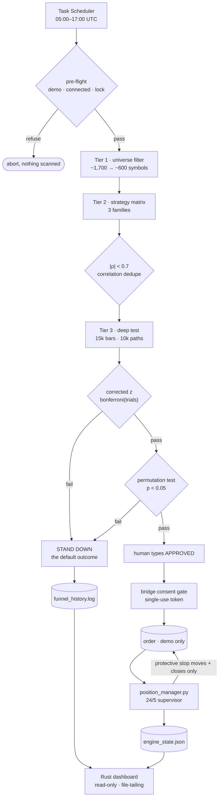
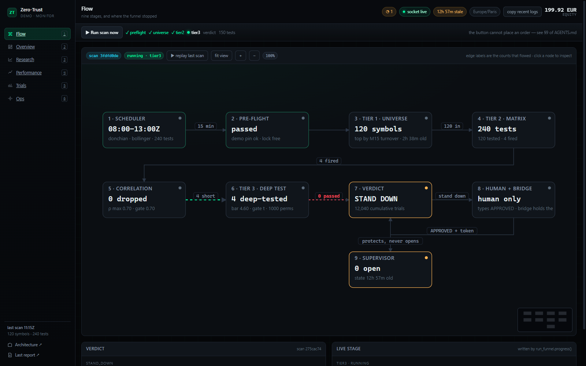

# Zero-Trust Trader

[](https://github.com/youcisla/Zero-Trust-Trader/actions/workflows/ci.yml)
[](LICENSE)
[](https://www.python.org/)

> **My AI agent has no authority to lose my money.**

An autonomous trading-research pipeline for MetaTrader 5 where the agent may look at
everything and do almost nothing.

A typical stand-down message (example, not live status):

```
Market is choppy, no statistically significant edge found today. Standing down.
```

That is not a failure message. That is the product.

**Stage 3 of a three-stage research arc** that began in March 2026. The earlier
systems are preserved, with the failure they measured, in
[`docs/LINEAGE.md`](docs/LINEAGE.md) — [TradeBot](https://github.com/youcisla/TradeBot)
(no edge) → [TradeBotV2](https://github.com/youcisla/TradeBotV2) (measurement
first) → this repository (refuses to trade).

---

## The one rule

**AutoTrading stays off for research.** Nothing in this repository enables it.
Any exceptional human-approved execution is governed by the external bridge;
research, tests, the dashboard and scheduled scans cannot grant that approval.

Every **entry** needs two independent approvals:

1. a human typing the literal word `APPROVED`, and
2. the MCP bridge's own consent gate — a separate process that returns an
   approval token the agent must echo back, with idempotency keys and a JSONL
   audit trail.

The agent cannot synthesize either one. It can only ask.

---

## Why this is the interesting problem

Anyone can wire an LLM to a broker API. The hard part is not execution — it is
building something that **refuses to trade**, and being able to prove the refusal
was correct rather than an excuse.

That requires two things most trading bots never build: an honest measure of how
many hypotheses were tried, and a gate that survives the answer being *no*.

---

## The result that justifies the whole design

> **Superseded 2026-11-05.** These numbers came from a backtest that did not
> match live execution: no EMA trend gate, no spread, and a fixed +1.5R target
> the supervisor never sets. The Time Machine now imports Tier 2's gate and the
> supervisor's own `next_stop()`, and charges the spread — enforced by
> `tests/test_parity.py`. Every figure below is being re-derived under the
> corrected rule. Treat the table as history, not as evidence about the system
> as it runs today.

I scanned 568 instruments, deep-tested the five strongest, and one candidate
looked like a genuine edge:

| `HNR1d.DE` | |
| --- | --- |
| Trades | 304 |
| Win rate | 46.9% |
| Break-even needed | 40.0% |
| **z-score** | **+2.40** |
| Avg R | +0.192 |

z = +2.40 clears the conventional 1.96 threshold comfortably. Any single-symbol
study would have called that a finding and sized a position on it.

It was **refused**. Against the corrected bar for 576 tests (z = 3.92), +2.40 is
unremarkable — precisely what taking the best of 568 draws produces by luck.

The same instrument was later re-tested on four times the history:

| `ETHAUD/rsi` | 5,000 bars | 15,000 bars |
| --- | --- | --- |
| Trades | 134 | **566** |
| z-score | −0.18 | **−0.50** |

Four times the data did not reveal a hidden edge. It made the estimate *worse* —
exactly what happens when the original reading was noise. The earlier sample
size was not "too small to tell"; it was hiding nothing.

---

## Four in-repo gates, plus two external approvals

| # | Gate | Where it runs | Failure it catches |
| --- | --- | --- | --- |
| 1 | **Universe filter** — live market, spread ≤ 15% of ATR, ≥ 160 days of history | this repo | trading an instrument that is shut, illiquid, or newly listed |
| 2 | **Correlation dedupe** — collapse candidates above \|ρ\| 0.7 | this repo | `AMD.US-24` vs `AMD.US-PERP` measure **+0.997**: the same bet billed twice |
| 3 | **Corrected significance** — Bonferroni z, or the *t* of mean R under `--t-gate` | this repo | the scan itself — 9,081 hypotheses tried means the bar is 4.54, not 1.96 |
| 4 | **Permutation null** — random entries, same fills, costs and exits | this repo | autocorrelation and barrier geometry that the analytic z assumes away |
| 5 | **Human `APPROVED`** | a human | the agent's own judgement |
| 6 | **Bridge consent gate** | a separate process | a compromised or confused agent |

Gates 1–4 are code in this repository and run on every scan. Gates 5 and 6 live
outside it: they govern *entry orders* and are only as strong as the bridge
deployment. Nothing in this repo can place an entry on its own — it has no order
path at all — and protective exits through the supervisor are single-approval by
design, because a stop you cannot move without a second signature is a stop you
cannot tighten when the market turns.

Gates 3 and 4 are not redundant. The permutation test is per-instrument and does
**not** correct for the scan: at 576 tests, a p-value of 0.015 is expected ~8
times per run. Passing one gate is not permission to trade.

Gate 3 tests the win rate by default. `--t-gate` tests the **mean R** instead,
because a binomial test on the win rate cannot see a low-win-rate, high-payoff
edge — 35% at +2.5R beats break-even and the win rate calls it a loss. The two
answer different questions and disagree on purpose: 55% at +0.01R with 45% at
−1.0R scores z = +4.8 and t = −14.0. Whichever statistic is used, the gate also
refuses a non-positive expectancy, so "lost more slowly than chance" cannot pass
the permutation null.

---

## Architecture



**Three strategy families**, because one is not enough: a breakout strategy fails
by construction in a sideways market.

| Family | Trigger | For |
| --- | --- | --- |
| `donchian` | close beyond the prior 20-bar channel + EMA trend filter | trending |
| `rsi` | RSI-14 crossing into <35 / >65 | chopping |
| `bollinger` | close crossing out of the 2.0σ band — **faded, not followed** | overshoots |

Two details that took measurement to find:

- **MACD was removed.** A line/signal cross is trend-following, so it duplicated
  Donchian's exposure instead of diversifying it. Adding a family raises the
  multiple-comparisons bar; it must also add a genuinely different bet.
- **RSI sparsity was a history-length problem, not a threshold problem.** Moving
  30/70 → 35/65 bought +70 trades. Moving 5,000 → 15,000 bars bought **+480**.
  Thresholds trade signal quality for volume; history *is* the sample.

**The matrix narrows with the session.** Scanning all three families for twelve
hours would add 7,200 hypotheses a day; narrowing the early sessions keeps it at
5,000 without giving up the Asian and London opens.

| Window (UTC) | Families | Why |
| --- | --- | --- |
| 05:00–08:00 | `donchian` | pre-London: structure is thin, only a breakout earns a test |
| 08:00–13:00 | `donchian`, `bollinger` | London range is real enough to fade |
| 13:00–17:00 | all three | NY overlap: full matrix |

`run_funnel.py --at-utc 08:00 --plan-only` prints the plan for any time without
touching the terminal.

---

## Backtesting every symbol

`tools/batch_backtest.py` runs the same Time Machine the funnel uses over every
symbol in the universe, one family at a time, and ranks them against the real bar:

```bash
python tools/batch_backtest.py --limit 40 --family donchian
python tools/batch_backtest.py --limit 0                     # every symbol, every family
```

It is a **pre-screen, not a gate**: it runs with `permutations=0` because a nought-
hypothesis test is what the gate exists for, and it says so in every row. A symbol
that clears the bar here still has to survive a full scan. The artifact
(`sweep_history.json`) is written next to the ledger and gitignored.

### On TradingView

We looked at the alternatives people actually recommend — Quantower, NinjaTrader,
TrendSpider, GoCharting, LuxAlgo Vela, OpenCharts — and wrote down what each one
is and why none of it changes the data source: [`docs/ALTERNATIVES.md`](docs/ALTERNATIVES.md).

TradingView's terms are explicit that their data is display-only: they forbid
automated access, scraping, and any non-display use — including building a dataset
through their MCP server — and they ban accounts for it. This project decides with
that data, so pulling it in would be exactly the prohibited case, on top of being
fragile. The backtest data comes from the broker that will fill the orders, which
is also the data we can defend.

## Live dashboard



A Rust (Axum) server streaming to a React UI: six pages behind one design
language. The default page is a **nine-stage flow canvas** (scheduler, pre-flight,
tier 1, tier 2, correlation dedupe, tier 3, verdict, consent, supervisor) with
live per-edge counts, a click-to-inspect drawer, zoom/pan/minimap and a ledger
replay. Behind it: a verdict hero, an equity and drawdown series collected in
memory, gate-margin and trials-activity heatmaps, universe health tiles, an
outcome mix, the cumulative-trials burn-up with a what-if mirror of the bar, the
full parsed ledger, the desk's four-agent chain with every stored answer, and an
alert rail derived on the server. The screenshot is the real thing running
against the demo account.

```bash
cd dashboard && cargo run --release        # http://localhost:8787
```

**Controls.** The ledger is 400 rows, so it is filtered and paged in the browser —
search across scan id, date and cumulative count, verdict chips with their counts,
25/50/100 per page. The candidate cards filter by family, search by symbol and sort
by |t|, average R or symbol. The canvas has a freeze button: a live graph is
unreadable while a scan is running, so freezing holds the snapshot you were looking
at and says so. None of it is a request — the rows are already in the snapshot, and
nothing on the page can touch the engine.

**Design rule: the engine never knows the dashboard exists.** No IPC, no callback,
no socket the Python side opens. The dashboard tails ordinary files the engine
already writes (`engine_state.<ns>.json` — a fresh generation each tick, never
a file a reader holds; `funnel_history.log`, `position_manager.log`,
`audit.jsonl`). Kill the dashboard and trading is unaffected; kill the engine
and the UI shows an amber staleness age rather than inventing numbers. A missing
file answers `null` and renders as `—` or "no engine state", never as `0`: a
dashboard that says "flat — standing down" while blind is the same class of lie
as a green "no data", and both were fixed here after being caught on screen.

| Endpoint | Purpose |
| --- | --- |
| `GET /` | the UI — one embedded HTML file, React vendored, no build step |
| `GET /api/snapshot` | one-shot state, last 12 lines of each log |
| `GET /api/logs/{audit,funnel,actions}` | bounded newest log excerpt with explicit truncation metadata; see [API contract](dashboard/API.md) |
| `GET /ws` | the snapshot on change, and again every 5 s regardless, so a quiet tree cannot be mistaken for a dead feed; the server pings every 15 s and the page reconnects itself when messages stop |
| `GET /architecture` | the generated stage map (Archify, embedded at build time) |
| `GET /api/report/latest` | the newest per-scan HTML report (`reports/run-*.html`) |
| `/vendor/echarts.min.js` | the chart bundle, vendored from a pinned npm tarball (sha256 in `PROVENANCE.json`) |
| `POST /api/scan` | **the only write in this process.** Takes no argument, so the button runs exactly what the scheduler runs — same lock, same window, same demo pre-flight. It cannot reach an order |

#> **Can a 50 EUR account become 1,000 EUR in a month?** `docs/SIZE-AND-RUIN.md`
> works it out with the broker's own numbers, the ruin distribution of the best
> measured edge, and the published statistics on day traders. Answer: no, and the
> reason is arithmetic rather than a missing strategy.

## Read the argument, not just the verdict

Every scan writes one page to `reports/run-<utc>.html` — the same page the
dashboard's **last report ↗** link opens. It lists each candidate with both
gates side by side: the corrected bar against the naive `1.96`, and the
permutation p-value. A candidate that dies at gate 1 shows what it *would* have
scored under a naive test, which is the whole reason the second gate exists:

```
GBPCAD  z = 3.278  vs corrected bar 4.5   -> rejected
        a naive 1.96 test would have traded it
```

That page is also the artefact to hand a reader who asks "how do you know?" —
it names the code SHA, the cumulative trial count and the permutation count, so
the number can be reproduced rather than believed. `report.py` builds it from
`tier3_results.json`; tier 3 calls it after writing the JSON, so a manual run is
documented exactly like a scheduled one.

### Debugging from the UI

Every log pane has a **copy** button that fetches a bounded newest excerpt from
`/api/logs/…`, with a visible truncation label when older content is omitted.
The header can collect the available log excerpts; failed requests are reported
rather than copied as if they succeeded. Review private logs before sharing them.

Panes are **newest first**. Oldest-first made a failure that was fixed hours ago
look current for as long as the 12-line window stayed full.

`audit.jsonl` is the event trail, not a test ledger: one JSON object per line
for verdicts, refusals and supervisor actions, written by `audit.write(...)`.
The trials ledger keeps counting trials; this records everything else. It is
appended to, never rewritten, and a failed write is swallowed on purpose —
auditing must never be able to break the thing it audits.

---

## Trials accounting, which is the whole point

Every scan appends its own hypothesis count to a durable ledger, and the
significance bar is derived from the accumulated total — not from the current
scan.

| Cumulative tests | z_crit |
| --- | --- |
| 1 (a single hypothesis) | 1.96 — no correction at all |
| 150 (one scan, three families) | 3.59 |
| 525 (the aborted wide run) | 3.90 |
| 1,791 (one full-universe run) | 4.19 |
| 5,388 | 4.43 |
| 9,081 (historical example) | 4.54 |
| **16,292 (today, 10 Nov 2026, 248 symbols)** | **4.67** |
| 52,000 (a day at 741 tests x 48 scans) | 4.92 |
| 265,000 (a week at that rate) | 5.21 |
| 1,084,000 (a month at that rate) | 5.47 |

This table is an illustrative historical snapshot, not a live trial count.
Every value is computed by `bonferroni_z()`, not estimated — `python status.py`
prints the current one. The window is 05:00–17:00 UTC (48 scans/day), but the
session matrix below narrows the families early, so a day adds 5,000 hypotheses
rather than the 7,200 a naive 12-hour expansion would.

```bash
$ python trials_total.py
9081
```

That number is what feeds `honest_backtest check trades.csv --trials 9081`.
Under-counting trials is the classic way a backtest lies; this repository refuses
to count only the runs that looked good.

---

## It can't lose money while you're asleep, either

Operational guarantees, each enforced in code rather than in documentation:

| Guarantee | Enforced by |
| --- | --- |
| Demo only | pre-flight aborts on any server without `demo` — verified in tests |
| No overlapping runs | process-lifetime OS locks; a stalled live owner cannot lose its lock by age alone |
| No stale signals | Tier 2 skips any instrument whose last bar is > 45 min old |
| No silent failure | a crashed funnel logs `FAILED`; the report prints `[STALE]` rather than a quiet market |
| Market Watch cleanup | selections made by the scanner are released; failed releases remain pending for retry |
| Nothing placed unattended | no scheduled job calls `place_order` at all |

The failure mode that shaped this design: **a system that reports success while
quietly doing nothing is worse than one that crashes.** Every guard above exists
because something silently lied at least once during development.

---

## Quick start

Needs Python **3.12–3.14** (the pinned NumPy version requires 3.12+), the
MetaTrader 5 terminal on Windows logged into a **demo** account, and Rust 1.96.0
if you want the dashboard. Use a dedicated environment; the tracked launchers
refuse to fall back to an arbitrary Python on PATH.

```powershell
git clone https://github.com/youcisla/Zero-Trust-Trader.git
cd Zero-Trust-Trader
py -3.14 -m venv .venv
.\.venv\Scripts\python.exe -m pip install -r requirements.txt
$env:MT5_EXPECTED_LOGIN = Read-Host "Numeric demo account login"

# This command does not connect to a terminal.
.\.venv\Scripts\python.exe run_funnel.py --at-utc 08:00 --plan-only

# Human-operated research commands; they never place entries.
.\.venv\Scripts\python.exe status.py
.\.venv\Scripts\python.exe run_funnel.py --rebuild
.\.venv\Scripts\python.exe run_funnel.py --window-utc 05:00-17:00
```

`MT5_EXPECTED_LOGIN` must be exported in the process/launcher environment; the
scanner does **not** load it from `.env`. `ZTT_LEDGER_KEY` and `DEEPSEEK_API_KEY`
are consumed by their own components and may use the private `.env` file.
`MT5_SERVER` and `ZTT_WINDOW_UTC` are not scanner settings; the window is a CLI
argument and the actual account server is inspected by preflight. `.env.example`
documents this distinction. Missing account pin remains a refusal.

Supervisor (dry run by default — it prints what it would do):

```bash
python position_manager.py                    # watches, changes nothing

```

Dashboard:

```bash
cd dashboard && cargo run --release            # http://localhost:8787
```

Windows Task Scheduler drives the cadence; `run_funnel.cmd` and
`run_rebuild.cmd` are provided. Nothing scheduled can place an order.

The consent-gate policy lives in `config.toml` at the repository root (not committed —
see `docs/BOTLAB_COMMAND.txt` for the ledger/backtest workflow).

## Tests

The regression suite needs **no trading terminal** — `MetaTrader5` is Windows-only, so
`tests/_mt5stub.py` stubs it and the indicator maths and safety guards run
anywhere, including Linux CI:

```bash
python tools/run_tests.py
```

CI runs the checked-in Ruff correctness rules over the source, a pinned Python
dependency audit, and stubbed tests on Linux and Windows. `compileall` only proves a
file parses; an undefined name parses fine and crashes at runtime, which is how
a `NameError` once reached production twelve runs in a row while CI stayed green.

## Verify safety without placing an order

`manual_e2e_test.py` now runs offline safety checks only. It has no direct
terminal execution or enable-AutoTrading prompt. Those checks cannot prove the
installed bridge's transport, consent-token lifetime or broker fill behavior.
Run the stubbed regression suite instead of opening a test position:

```text
python tools/run_tests.py
```

There is no repository entry-order flow. A human who separately validates the
external bridge must retain its independent approval/idempotency controls and
initial protective stop; the agent cannot authorize that live validation.

## Two switches only a human holds

**Armed execution.** `--apply` on the supervisor is a request, not a permission.
It is honoured only when `ZTT_ALLOW_APPLY=1` is set in the shell that launched
it; otherwise the process stays in dry run and says why. A command string an
agent can build is not consent.

**Ledger integrity.** Every trial row is signed into an HMAC chain keyed from
`ZTT_LEDGER_KEY` (env, or `.env` in the execution dir — never committed).
`status.py` and `trials_total.py` verify the chain and print `!! LEDGER TAMPERED`
if a row was edited, deleted or reordered. Rows written before the chain existed
are reported as `unsigned` rather than silently trusted, and writing a new
unsigned row now says so on stderr — a fresh clone without `ZTT_LEDGER_KEY` gets
a ledger that is only as trustworthy as the disk, and it tells you.

| Suite | Covers |
| --- | --- |
| `test_math` | RSI / MACD / ATR / Donchian / Bollinger edge cases, Bonferroni values, naive-vs-corrected |
| `test_safety` | demo-only pre-flight, the run window, lock acquire / refuse / stale takeover |
| `test_ledger` | trials accounting, including that `LEGACY_TRIALS` is frozen |
| `test_position_manager` | protective-direction rule as a 3,000-case property sweep, break-even, session close, exclusive lock |
| `test_parity` | every scanner is graded with the exit policy its null is graded on |
| `test_t_gate` | z and t disagree in both directions; the gate refuses a non-positive expectancy |
| `test_broker_offset` | a frozen weekend tick must not be mistaken for the broker clock |
| `test_funnel_wiring` | `--t-gate` reaches tier 3 without appending a row to the production ledger |

The dashboard has its own Rust fixture tests (`cd dashboard && cargo test --locked`).

The suite exists because two bugs in this codebase were **silent**: RSI returned
100 on a flat series (a dead instrument reading as overbought, firing a false
short) and MACD's signal line was all-NaN (a strategy family that looked
implemented and could never fire). Neither raised an error; both now have a
regression test.

CI also fails the build if a machine path, broker account number, or key prefix
appears in the tree — the sanitiser is enforced rather than remembered.

---

## What this does not do

- It does not claim an edge. It has found none.
- It does not predict prices, and no part of it is financial advice.
- It does not touch a live account — the pre-flight refuses one.
- It is not a strategy. It is the machinery that decides whether a strategy
  deserves to exist.

---

## License

MIT. See `LICENSE`.

Built as a demonstration that **"the AI declined to trade" can be a measurable
result rather than a slogan.**


## Reproducible release and recovery

`tools/build_public.py` is the tracked publication builder. It copies only
privacy-checked tracked source into a new artifact, rejects missing required
files/local imports, records file hashes, and never mirrors runtime state.
`python tools/build_public.py --check` validates a temporary build and runs its
stubbed regression suite. Newly added code must be tracked before it can be part
of a release. Existing output directories are never deleted or overwritten.

`export_ledger.py` creates immutable, uniquely named range exports under ignored
`exports/`; it never rewrites the canonical `trades.csv` and refuses an existing
output target. The canonical ledger remains private and must retain all losses.

See [operations and recovery](docs/OPERATIONS.md),
[vendor provenance](docs/VENDOR-PROVENANCE.md), and the
[audit/fix record](docs/audit-2026-11-09/README.md). Current run state belongs in
the dashboard/diagnostics, not in static README examples.
